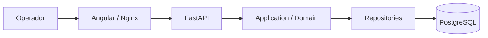

# NOC Flow Cloud v2

<p align="center">
  
</p>

[](https://github.com/MSsanto/P0-NOC-Flow-Cloud-v2-/actions/workflows/ci.yml)

Aplicação web para operação e acompanhamento de incidentes de NOC. O projeto nasceu da necessidade de concentrar contexto operacional, histórico e passagem de turno em um único fluxo.

## Stack

- Angular + TypeScript
- FastAPI + Python
- PostgreSQL + SQLAlchemy + Alembic
- Docker / Docker Compose
- GitHub Actions
- Cloudflare Workers + D1 para a demo privada
- OIDC / Cloudflare Access + RBAC

## Funcionalidades

- criação, consulta e atualização de incidentes;
- timeline append-only;
- normalização de incidente;
- filtros, paginação e ordenação;
- isolamento por tenant;
- autenticação e autorização por papéis;
- dashboard operacional;
- passagem de turno com snapshot versionado;
- health checks e request correlation;
- demo privada protegida por Cloudflare Access.

## Arquitetura

O backend é um monólito modular. A regra de negócio fica fora das rotas HTTP e a persistência é acessada por repositories.



A demo privada usa um adapter em Cloudflare Worker/D1, mantendo o contrato HTTP compatível com a aplicação principal.

## Rodando localmente

### Docker

```bash
git clone https://github.com/MSsanto/P0-NOC-Flow-Cloud-v2-.git
cd P0-NOC-Flow-Cloud-v2-
docker compose up -d --build
```

Acessos locais:

- Frontend: `http://localhost:4200`
- API: `http://localhost:8000/api/v1`
- Swagger: `http://localhost:8000/api/v1/docs`
- Readiness: `http://localhost:8000/api/v1/health/ready`

Para encerrar:

```bash
docker compose down -v
```

### Backend sem Docker

```bash
cd backend
python -m venv .venv
python -m pip install -e ".[dev]"
alembic upgrade head
uvicorn app.main:app --reload
```

### Frontend sem Docker

```bash
cd apps/web
npm ci
npm start
```

## Testes e qualidade

O CI executa lint, migrations, testes de backend, cobertura, auditoria de dependências, type-check, testes frontend, build e smoke tests do stack completo.

Comandos úteis:

```bash
cd backend
ruff check .
pytest

cd ../apps/web
npm run lint
npm test
npm run build
npm audit --audit-level=high
```

## API principal

```text
GET  /api/v1/auth/me
GET  /api/v1/dashboard/summary
GET  /api/v1/handovers/preview
POST /api/v1/handovers
GET  /api/v1/handovers
GET  /api/v1/handovers/latest
GET  /api/v1/handovers/{handover_id}

GET  /api/v1/incidents
POST /api/v1/incidents
GET  /api/v1/incidents/query
GET  /api/v1/incidents/{incident_id}
POST /api/v1/incidents/{incident_id}/updates
POST /api/v1/incidents/{incident_id}/normalize
GET  /api/v1/incidents/{incident_id}/timeline

GET  /api/v1/health/live
GET  /api/v1/health/ready
```

## Segurança

A aplicação valida identidade externa, resolve memberships internamente e aplica autorização server-side. `tenant_id`, ator e timestamps não são aceitos do cliente como fonte de autoridade.

O repositório usa somente dados sintéticos. Tokens, credenciais, circuitos, contatos ou dados corporativos reais não devem ser versionados.

## Documentação

A documentação técnica foi mantida curta e próxima do código:

- [Arquitetura](docs/03-ARCHITECTURE.md)
- [Modelo de domínio](docs/04-DOMAIN-MODEL.md)
- [Modelo de dados](docs/05-DATA-MODEL.md)
- [Contrato da API](docs/06-API-CONTRACT.md)
- [UX e fluxos](docs/07-UX-FLOWS.md)
- [Segurança](docs/08-SECURITY-PRIVACY.md)
- [Testes](docs/09-TEST-STRATEGY.md)
- [Deploy](docs/deployment/README.md)
- [ADRs](docs/adr/README.md)
- [Case técnico](docs/portfolio/CASE-EVIDENCE.md)

## Próximos passos

- consolidar auditoria persistida;
- adicionar métricas/tracing;
- preparar deploy Azure;
- evoluir integrações com monitoramento, notificação e ITSM.

## Autor

Matheus Santo

## Licença

Consulte [LICENSE.md](LICENSE.md).
